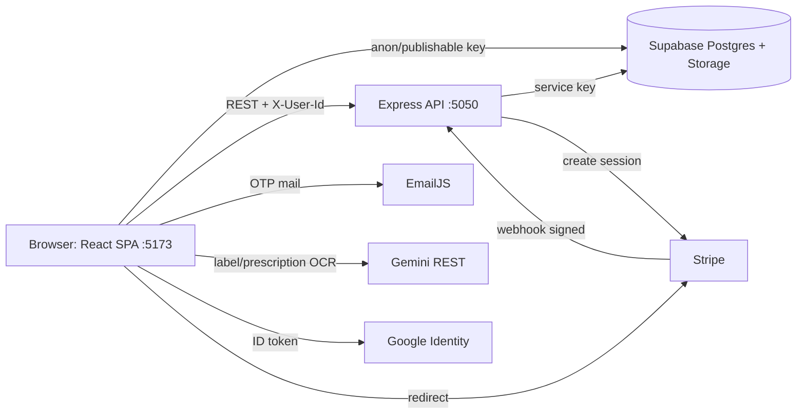

# Architecture

## Components

## Data flows
| Flow | Path |
|---|---|
| Most CRUD (catalog, cart, reminders, alerts, orders read) | Browser → Supabase directly (`Client/src/lib/*Service.js`) |
| Checkout | Browser → `POST /api/stripe/create-checkout-session` → Server reads cart (service key), creates `orders`+`order_items` (unpaid) → Stripe session URL → browser redirect |
| Payment confirm | Stripe → `POST /api/stripe/webhook` (raw body, signature) → `orders.payment_status=paid`, `admin_payment_status=pending`, stock −, `stock_transactions`, cart cleared |
| Admin approval | Browser (admin) → Supabase `orders.admin_payment_status` |
| Images | Browser → Storage bucket `DatabaseAssets` |

## Auth model (custom, not Supabase Auth)
- Table `users`; password = `salt:sha256hex(password+salt)` (`passwordService.js`).
- Session = user object in `localStorage` (`authService.getStoredUser`). No token, no expiry.
- Roles: `user`, `vendor`, `admin`, `doctor` (doctor treated as user in routes).
- Google: ID token decoded in browser (no signature check).
- Server identifies caller only by `X-User-Id` header.
- `auth.uid()` unavailable → RLS cannot scope rows per user.

## Trust boundaries
| Boundary | Current state | Risk |
|---|---|---|
| Browser ↔ Supabase | publishable key, RLS `USING (true)` | anyone can read/write any table (K2, K4) |
| Browser ↔ Server | `X-User-Id` header trusted | spoofable (K8) |
| Stripe ↔ Server | signature verified | OK |
| Server ↔ Supabase | service key, server only | OK |
